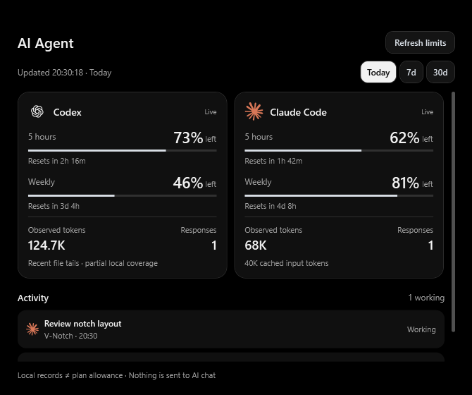

# AI Agent — additive V-Notch page

This addition is on `codex/ai-agent`, based on the completed LocalSend customization. It keeps upstream Spotlight AI chat, its API providers, conversations, settings and usage displays intact. New C# readers were implemented independently for this page; no GPL Islet/Vorssaint implementation files were copied into V-Notch.

## Use

Expand the notch and select the **AI Agent** icon (four squares). It is appended to the existing navigation order. Drag it like the other tabs, or hide/show it in the existing Settings navigation-tab list. The page uses the existing shell, coordinator, outside-click dismissal and reduced-motion behavior. Reopen-last-view also supports it.

- **Today / 7d / 30d** changes the period for observed local records and recent activity.
- **Refresh limits** asks the installed Codex and Claude Code CLIs for account limits. It sends no AI prompt, starts no conversation and signs into no account. There is a 30-second cooldown. Account refresh is manual; opening the page only reads local files.
- Quota windows display **remaining percentage**, reset time and a **Live / Snapshot** label. Hover a window for its source and observation time. Expired windows show a dash and request a refresh. No published reading means no percentage.
- A sign-in-related error can offer **Copy sign-in command**. Paste that command into PowerShell and complete sign-in yourself, then refresh. This page never reads credential files or automates login.
- Local tokens, cached input and response counts are separate from subscription allowances. Missing records show a dash, not zero allowance.
- Claude session files are checked against live local PIDs. Explicit busy/idle states become Working/Waiting. Older files without a state say Running. Codex activity comes from recorded task events and is labelled Recorded active/Recent; it is not a process-liveness claim.



## Local sources and bounds

The reader honors `CODEX_HOME` and `CLAUDE_CONFIG_DIR`, otherwise using the user's `.codex` and `.claude` directories. It reads session/project JSONL usage fields and Claude session-state JSON files. Conversation text is discarded during parsing, never retained in the snapshot, logged or sent elsewhere.

At most 64 recent JSONL files per provider are read, up to 256 KiB from each tail; an initial Codex metadata line can additionally supply the project label. Truncated tails and skipped/locked files are labelled **partial local coverage**. Observed tokens are therefore not a complete billing total. Repeated cumulative Codex events and streaming Claude response updates are deduplicated. File metadata caches avoid reparsing unchanged logs.

Local polling runs every five seconds only while this page is visible. Closing/hiding it cancels pending work. CLI probes run on worker threads, use bounded responses and a 25-second deadline, close their own input on completion and terminate only their own subprocess tree if it does not exit. Existing agent processes are never stopped. Claude tools, hooks, MCP servers, updater and telemetry are disabled for the short-lived probe process; user configuration is not rewritten.

Account network access uses the existing V-Notch AI privacy permission. Strict Local-Only Mode prevents those checks and revocation cancels them. Local activity remains available without account access. Existing privacy defaults are unchanged.

Protocol references: [official Codex app-server documentation](https://learn.chatgpt.com/docs/app-server), [Anthropic Agent SDK](https://github.com/anthropics/claude-agent-sdk-typescript). Claude's `get_usage` control response is version dependent; unsupported/missing readings are explicit states rather than estimated quota. The provider SVG assets retain their original bytes and provenance in `Assets/Agents/README.md`; the native DrawingImage resources preserve their path data, colors and viewBox clear space.

## Verification

```powershell
./Test-Agents.ps1 -DotNetExe ../dotnet-sdk/dotnet.exe
./Test-LocalSend.ps1 -DotNetExe ../dotnet-sdk/dotnet.exe
./Build-LocalSend.ps1 -DotNetExe ../dotnet-sdk/dotnet.exe
```

- 10 synthetic core cases cover deduplication, cache counting, optional session status, live PID/domain guards, expired/missing quotas, privacy denial, changing files, cancellation and bounded tails.
- 5 isolated WPF/presentation cases cover missing states, narrow/normal layouts, dark rendering, selection/collapse across the Agent page and every legacy view, and coordinator transitions. They compile the actual presenter/coordinator sources; only logging/display-preference services are substituted in that isolated harness.
- Existing LocalSend core regression tests pass (24). Its 2 UI cases passed previously; this run's UI rerun was blocked by Windows Application Control (`0x800711C7`) with zero discovered tests. The harness correctly fails that run rather than reporting it as a pass. No alternate packaging, policy changes or trust-store changes were used to bypass the block.
- The complete application and full test project compile. The complete application test assembly remains subject to the previously recorded Windows Application Control test-host limitation; isolated passes are not claimed as a complete regression run.
- A read-only live probe found Codex account quota windows and local activity for both providers. On this machine, Claude's CLI returned no account quota windows. The UI reports that state and offers sign-in guidance. It does not invent Claude quota or claim sign-in succeeded.
- Synthetic previews verify layout, not the user's actual quota or every animation timing on physical displays. LocalSend's physical iPad roundtrip is still unverified.

The standalone diagnostic `Tests/Agents.Probe` is opt-in and prints counts/status only. Run with `--accounts` to include explicit read-only account checks; without it, only local files are read. It never prints conversations, identity/account response bodies, keys or tokens.

Only additive view/navigation/presenter hooks and an Agent visibility preference touch the existing application. Music/lyrics receive an auxiliary-view guard so canvas content cannot appear over the Agent page. Existing tab preferences and all existing feature implementations remain in use.
