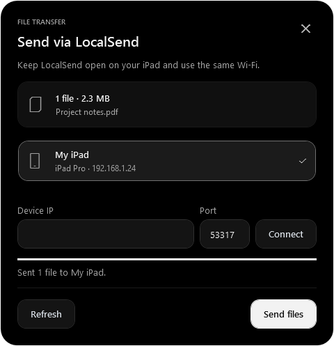

# V-Notch 2.1.0 — local LocalSend addition

This is a separate custom source checkout on `codex/localsend-transfer`. It is based on rainaku/V-Notch commit `b843d2340bacd94bab1b4ea6439fb29b91555f17`. Its original application, controls, windows, services and models match the `v2.1.0` release tag. The installed application at `E:/V-Notch` reports 2.1.0 and has not been replaced or modified.

## What was added

Public file and image cards in the existing clipboard shelf have one extra context-menu action: **Send via LocalSend…**. Existing music, animations, settings, gestures, clipboard actions, providers and other modules retain their upstream implementation.

The new send window follows `Windows/SpotlightPreferencesDialog.xaml`: the bundled SF Pro Display font, neutral gray surfaces, 24px shell corners, 14px cards, 12px controls, 42px buttons, and a white primary action. Its shell stays black. Rounded editors, keyboard focus, readable secondary text, selected-device checks, progress, cancellation, PIN requests and retry messages belong only to this window. The UI is English.



## Using it

1. Run a custom build allowed by your Windows application policy. Close the official V-Notch instance first; upstream single-instance behavior is retained. The custom build uses the existing upstream settings/data location, so it is not a separate settings profile.
2. Open LocalSend on the iPad, keep it in the foreground and connect both devices to the same local network. LocalSend does not need to be installed on the Windows PC for this addition.
3. Add a file, folder or image to V-Notch's existing clipboard shelf. Right-click its public card (or select multiple eligible cards) and choose **Send via LocalSend…**.
4. Select the receiving device and choose **Send files**. Accept the request on the iPad. If a PIN is required, enter the receiver's PIN and retry.
5. If discovery is unavailable, enter the receiver's local **Device IP** and **Port**, choose **Connect**, then **Send files**. The default port is 53317; use the value configured on the receiver if different. Network isolation or a firewall can also prevent manual connections.

Discovery starts when this window opens and stops when it closes. Transfers can be cancelled with **Cancel** or Escape; Escape closes an idle window. Closing the window cancels pending work. Shelf items are retained after sending.

The existing **Strict Local-Only Mode** also blocks this new network feature. Its setting is respected without changing the existing privacy rules. Revoking permission cancels in-flight work.

## Supported scope

- Send-only implementation of the [official LocalSend v2 protocol](https://github.com/localsend/protocol/blob/main/README.md): discovery, manual registration, preparation/acceptance, PIN, partial acceptance, streamed uploads and cancellation.
- Nearby IP addresses only, no proxy or redirects. HTTPS pins the receiver certificate fingerprint; explicit manual-IP discovery establishes the pin for that dialog. Receivers configured for HTTP also work and use unencrypted transport.
- Multiple files and folder-relative names; up to 4096 files and 32 directory levels. Empty directories, links/reparse points and network-share paths are not sent.
- Only public, unmasked, non-sensitive file/image cards qualify. Personal-vault entries and text/link cards do not get the new action.
- No receiving server or browser download mode. The small registration listener is for device discovery, not accepting files.

## Build and test

Windows x64, the .NET 8 desktop runtime and SDK **8.0.423** are required; the SDK version is pinned by upstream `global.json`. Dependencies use the original application lockfile.

```powershell
./Test-LocalSend.ps1
./Build-LocalSend.ps1
```

To use the isolated SDK already downloaded for this workspace:

```powershell
./Test-LocalSend.ps1 -DotNetExe ../dotnet-sdk/dotnet.exe
./Build-LocalSend.ps1 -DotNetExe ../dotnet-sdk/dotnet.exe
```

The build is written to `artifacts/localsend/`; keep the whole folder, including the native runtimes, models, notices and other upstream assets. The scripts do not install, launch or replace the installed application. The workspace SDK was not installed globally.

The upstream update system is retained. An official update can replace custom changes; keep this branch and rebuild/rebase the addition for later releases.

## Verification and limits

- 24 isolated core tests: protocol parsing/bounds, file selection, partial acceptance, error statuses, PIN encoding, permission denial/revocation, cancellation, and real loopback mutual-TLS upload with exact byte verification. A wrong certificate pin is rejected before metadata is sent.
- 2 isolated WPF tests: loading/empty/selected/PIN/success/pending/cancelled states, preserved PIN during discovery updates, layout bounds at 420px, five visible port digits, original visual tokens, and an offscreen rendered preview using the actual new XAML and bundled fonts. No native application window is shown.
- The application Release publish and the full test project compile. This is not a full application runtime verification.
- **Full application tests are blocked on this machine**: Windows Application Control refuses to load the custom `V-Notch.dll`, error `0x800711C7` (Code Integrity event 3077). The resulting “No test matches” message is not a passing test result. No security policy, trust store or installed executable was changed. A full build allowed by the machine's signing/application policy is needed for integrated testing and use here.
- A physical iPad transfer has not been tested. The preview uses synthetic device/file data; loopback protocol tests do not prove Wi-Fi discovery or iPad compatibility on the user's network.

The isolated suites compile only the new component sources; they do not load or launch the blocked V-Notch application. `Test-LocalSend.ps1` checks fresh TRX reports and actual passing test counts, including a guard against zero tests being reported as success.

## Integration footprint

Only two existing production files change: two additive shelf-menu calls in `Controls/ClipboardTray.xaml.cs`, and one appended `LocalSend` feature enum member in `Services/NetworkPrivacy.cs`. The existing test project excludes the new nested test projects' generated sources. All other implementation lives in new `Controls/ClipboardTray.LocalSend.cs`, `Services/LocalSend/`, and `Windows/LocalSendWindow.*` files.

Upstream Apache-2.0 `LICENSE` and third-party notices are retained. Changed existing files carry modification notices. Nothing has been pushed, merged, installed over the official app or migrated from the former Islet application.
