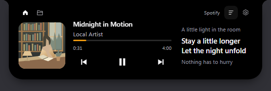
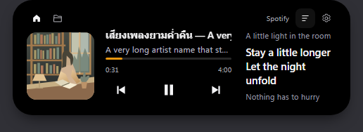

# V-Notch adaptation — Music, first pass

รอบนี้ต่อจาก [source assessment](v-notch-assessment.md) และปรับหน้า hover เพลงตามภาพอ้างอิงที่ผู้ใช้ส่งมา

## ที่ทำแล้ว

- **Hover player:** ปรับรอบสองเป็นสามส่วนตามภาพอ้างอิง ปก 96px ทางซ้าย, title/artist/timeline/controls ที่กระชับกลางแผง และ lyrics หรือข้อมูลอัลบั้มจริงทางขวา Home เปิด module overview, Folder เปิด Files และ Gear เปิด Settings กดควบคุมแล้วไม่เปิดหน้าเอง ปล่อยเมาส์แล้วหุบอัตโนมัติ
- **ขนาดและสี:** hover ใช้ความกว้างที่ตั้งไว้ 480–640px สูง 164px รองรับทั้ง notch และ capsule พื้นดำ สีจากเพลงอยู่เฉพาะ meter/seek/equalizer
- **Lyrics:** กดไอคอนข้อความด้านบนเพื่อเปิด synced lyrics จาก [LRCLIB](https://lrclib.net/docs) โดยส่ง title/artist/album/duration ของเพลงปัจจุบันเมื่อเปิดฟังก์ชันและเปลี่ยนเพลงขณะเปิดอยู่ ฟังก์ชันเริ่มปิดทุกครั้งที่เปิดแอป ไม่บันทึกเนื้อเพลงลงดิสก์ แคช memory จำกัด 32 รายการ มี timeout, cancel, stale-result guard และเคารพ Retry-After ถ้าไม่มีเนื้อเพลงจะแสดงข้อมูลอัลบั้มและสถานะจริง
- **Local lyrics:** Shift-click ไอคอนเดียวกันเพื่อเลือก `.lrc` บนเครื่อง รองรับ UTF-8, offset, timestamps ซ้ำ/ข้อความหลายภาษาและการ seek จำกัดไฟล์ 256KiB และรายการใน memory 8 เพลง ไม่อัปโหลดไฟล์หรือ path ไปยัง provider
- **เลือกเพลง:** แยก pure PowerShell policy จาก WinRT sampling ให้ playing ชนะ paused, จำการเริ่มเล่นใหม่, ไม่สลับตาม enumeration order และหน่วง source ที่ไม่มีหลักฐานใหม่ การเริ่มเล่นล่าสุดยังถูกเลือกหลัง bonus ชั่วคราวหมด
- **Pin source:** dropdown เดิมปักหมุดระดับ application เมื่อ player หายจะรอแอปเดิม มีปุ่มกลับ Automatic และไม่เปลี่ยนไปควบคุมอีกแอปเอง หากหลาย SMTC session ใช้ app ID เดียวกัน จะเลือก OS-current instance ก่อน ไม่อ้างว่าปักหมุด browser tab ได้
- **Recovery:** probe metadata ถี่ขึ้นช่วงแรกแล้วกลับสู่รอบปกติ Browser session gap ถือภาพเดิมไม่เกินสองวินาทีและปิด transport controls ชั่วคราว deadline ยังหมดได้แม้ bridge ไม่ส่ง state ต่อ ส่วน metadata grace เดิมยังจำกัด 1.5 วินาทีและรับสถานะ Pause จริง
- **Artwork:** แต่ละตำแหน่งมี decode request ของตัวเอง ตัด callback เก่าที่มาช้า ไม่โหลดซ้ำตาม poll/resize และไม่เอาปกเพลงก่อนมาแสดงคู่กับชื่อเพลงใหม่
- **Transition:** ใช้ geometry revision และ spring เดิมของ Islet ตรวจ rapid reversals/เปลี่ยนเพลงกลาง morph แล้ว ไม่เพิ่ม animation engine หรือ resize native host ระหว่าง morph

ภาพเป็น screenshot จาก renderer จริง ใช้ข้อมูลเพลงและ artwork สังเคราะห์สำหรับทดสอบ

## ขอบเขตที่ยังไม่ได้พอร์ต

V-Notch รับ WinRT events ด้วย C# แต่ Windows PowerShell ไม่รองรับ `Register-ObjectEvent` ของ WinRT (ตรวจบนเครื่องนี้แล้ว) รอบนี้จึงรักษา bridge เดิมและ watchdog ไม่เพิ่ม worker ใหม่ backoff ถูกจำกัดไม่ให้ช้ากว่า poll ปกติ 900ms การทำ native event helper, fullscreen/desktop-layer และ audio mixer ยังเป็นงานลำดับถัดไป ไม่มีข้อมูล battery สมมติในหน้า hover

## ตรวจสอบ

- `npm test`: ชุดทดสอบเดิมผ่าน รวม LocalSend mock receiver, media state/intent และ display geometry
- `npm run test:media:bridge`: policy replay/adapter/recovery 26 checks และ targeted playback, request IDs, duplicate app instances กับ fallback ผ่าน ไม่ส่ง media keys จริง
- `npm run test:media:artwork`: decode/error/clear race และ deduplication ผ่าน
- `npx electron test/renderer-smoke.js`: 137 renderer checks ผ่าน
- `npm run test:music:hover`: 32 layout/control/lyrics/reversal checks ผ่าน
- `npm run test:lyrics`: query ปลายทางคงที่, cache, timeout/cancel, offline, rate limit, LRC parsing และ file limits ผ่าน
- ทดสอบ HTTPS กับ LRCLIB จริงด้วย metadata สาธารณะจากภาพอ้างอิง พบ synced lyrics 13 บรรทัด โดยไม่อ่านเพลงที่ผู้ใช้กำลังฟังและไม่พิมพ์เนื้อเพลงออก log
- `npx electron test/music-playback-ui.js`: 14 checks ผ่าน
- `npx electron test/capsule-hover-ui.js`: 21 contour/pixel/interaction checks ผ่าน
- `npx electron test/notch-theme-ui.js`: 20 rendered-pixel/color-scope checks ผ่าน
- `node test/media-live-read.js`: อ่าน Windows SMTC session จริงผ่าน ไม่ได้ส่ง playback commands จริงในการทดสอบ

Offscreen renderer ยืนยัน behavior/layout และดูภาพแล้ว แต่ไม่ใช่การวัด frame pacing ของ DWM ขณะใช้หลายจอจริง

Source revision และ Apache-2.0 attribution อยู่ใน [THIRD_PARTY_NOTICES.md](../THIRD_PARTY_NOTICES.md)
